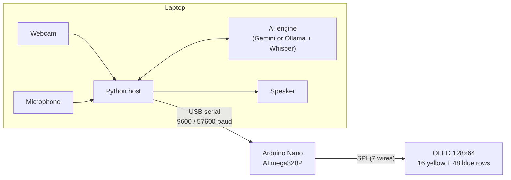

# Nano Lab

**Gesture- and voice-driven interaction on an Arduino Nano with a 128×64 OLED**

[](LICENSE)
-00979D)


> **Live website (English, Français, العربية):** `https://YOUR-USERNAME.github.io/nano-lab/`
> Other languages of this README: [العربية](README.ar.md) · [Français](README.fr.md)

---

## Abstract

An Arduino Nano has 2 KB of SRAM, far too little to process camera frames or speech. This repository studies how far such a device can go as an *interaction endpoint* when perception is delegated to a host laptop and the microcontroller is reduced to state update and rendering on a 0.96-inch two-colour OLED (128×64). Three prototypes of increasing complexity are presented: **(1) Dino**, a single-command control channel (one byte per jump); **(2) Gesture Games**, a continuous 4-byte state stream driving four arcade games; and **(3) Robo**, an embodied conversational agent whose expressive face is rendered with bounded memory and whose "brain" can be exchanged between a cloud model, a token-saving cloud variant, and a fully local pipeline. All firmware, host software, protocol specifications and a trilingual project website are included.

## Contents

1. [Motivation and research questions](#1-motivation-and-research-questions)
2. [System overview](#2-system-overview)
3. [Hardware](#3-hardware)
4. [The three prototypes](#4-the-three-prototypes)
5. [Serial protocols](#5-serial-protocols)
6. [Embedded design notes](#6-embedded-design-notes)
7. [Validation status](#7-validation-status)
8. [Reproducing the work](#8-reproducing-the-work)
9. [Limitations and threats to validity](#9-limitations-and-threats-to-validity)
10. [Future work](#10-future-work)
11. [Ethics, privacy and security](#11-ethics-privacy-and-security)
12. [Repository structure](#12-repository-structure)
13. [Citation, license, acknowledgements](#13-citation-license-acknowledgements)
14. [References](#references)

## 1. Motivation and research questions

Camera- and voice-based interfaces are normally associated with powerful hardware. The projects here ask what happens at the opposite end of the spectrum, with parts a student can buy for a few dollars.

- **RQ1.** Can an ATmega328P (2 KB SRAM, 16 MHz) run interactive games controlled by vision-based hand gestures, using only a serial link to a laptop?
- **RQ2.** What is the smallest serial protocol that is still sufficient for each interaction style (discrete command, continuous state, multimodal conversation)?
- **RQ3.** How can an expressive animated face (smooth transitions between emotions, gaze, lip-synchronisation) be rendered within the memory budget of the microcontroller?
- **RQ4.** What are the practical trade-offs between cloud, token-optimised cloud and local AI back-ends for a voice agent (cost, quota, internet dependence, latency, quality)?

## 2. System overview



The laptop performs every computationally heavy step (hand tracking, face detection, voice-activity detection, speech recognition, language model, speech synthesis). The Nano only parses a few bytes, advances a small state machine and draws.

## 3. Hardware

| Part | Notes |
|---|---|
| Arduino Nano (ATmega328P) | Header pins **must be soldered**; pins merely pressed into a breadboard leave an air gap and the display stays black. |
| OLED 0.96", 7-pin SPI, 128×64, two colours | Top 16 rows yellow, lower 48 rows blue. Controller is SSD1306-compatible; many modules use **SH1106**. |
| 7 jumper wires (female–male), breadboard | |
| USB cable, laptop with webcam and microphone | |

Wiring (identical for all prototypes):

| OLED pin | Nano pin | Role |
|---|---|---|
| GND | GND | Ground |
| VCC | 5V | Power |
| D0 (CLK) | D13 | SPI clock |
| D1 (MOSI) | D11 | Data to display |
| RES | D8 | Reset |
| DC | D9 | Data / command select |
| CS | D10 | Chip select |

Details: [documentation/hardware.md](documentation/hardware.md).

## 4. The three prototypes

### 4.1 Dino — single-command control

A Chrome-style dinosaur game runs entirely on the Nano. The laptop sends the byte `J` when a raised hand is detected.

| Item | Specification |
|---|---|
| Perception | MediaPipe Hands, 1 hand, detection confidence 0.7, mirrored frame |
| Gesture rule | index fingertip higher than the wrist by more than 0.2 of the image height; **rising edge** only |
| Message | one byte `J` at 9600 baud (jump, start, or restart; `R` is accepted as an alias) |
| Game loop | 30 ms per frame; jump launch speed −7 px/frame, gravity 0.8 (≈ 17 frames in the air, ≈ 31 px high) |
| Difficulty | speed 3 px/frame rising with score to 5.5; small, tall and double cacti; hitboxes 1 px smaller than the sprites |
| Rendering | U8g2 full-buffer mode, 16×16 sprite with a two-frame run cycle |

Files: `firmware/dino/dino_game/dino_game.ino`, `software/dino/dino_controller.py`.

### 4.2 Gesture Games — continuous state stream

One sketch contains a menu and four games. The host streams palm position and finger count; each game interprets them differently.

| Game | Gesture mapping | Key parameters |
|---|---|---|
| Flappy Bird | close fist, then open hand = flap | gravity 0.3, flap −3.4, gap 22 px, pipes 12 px wide at 2 px/frame |
| Pong | hand height = paddle position | 3 lives, ball speed ×1.05 per return (max 4.5 px/frame), AI paddle 1.6 px/frame |
| Snake | hand displacement from centre = direction (dead zone ±16 of 100) | 25×9 grid of 5 px cells, wrap-around walls, step 170 ms − 3 ms per segment (min 80 ms) |
| Shooter | hand x = ship x, automatic fire | 3 lives, ≤ 5 enemies, ≤ 4 bullets, shot every 8 frames, enemy speed 0.5 + 0.01·score (max 1.6) |

Perception details: palm centre is landmark 9, taken from the central 70 % of the image and smoothed with an exponential filter (α = 0.6). The finger count compares each fingertip's distance to the wrist with that of its middle joint (thumb: distance to the base of the little finger) and is the **majority vote of the last 5 frames**. Menu selection requires holding 1–4 fingers for 0.8 s; after Game Over a fist held for 0.6 s retries and five fingers return to the menu; the key `m` returns to the menu at any time.

Files: `firmware/gesture-games/gesture_games/gesture_games.ino`, `software/gesture-games/gesture_controller.py`.

### 4.3 Robo — embodied conversational agent

**Face.** Eyes, eyebrows, mouth and small effects (tears, blush, sound bars, thinking dots, sleep marks) are drawn procedurally. Expression parameters (eye width and height, cheek lift, lid slant, brow position and tilt, mouth curvature) are **interpolated every frame**, so emotions morph instead of switching. Cheek lift turns an eye into a smiling crescent by erasing a disc from below. The face has four states (idle, listening, thinking, speaking) and nine emotions (neutral, happy, sad, angry, surprised, love, sleepy, wink, laugh), plus randomised blinks, glances and occasional spontaneous winks or smiles.

**Perception.** An energy-based voice-activity detector (30 ms blocks, threshold calibrated from one second of room noise, 0.3 s pre-roll, 1 s of silence ends a turn) records the user. In parallel an OpenCV Haar cascade finds the largest face in a 320×240 frame; its position drives the gaze. A face reappearing after 8 s triggers a greeting; 90 s without voice or face puts the face to sleep.

**Interchangeable back-ends** (all share the same face firmware and protocol):

| | `voice_face_ai.py` | `voice_face_gemini_lite.py` | `local_voice_face.py` |
|---|---|---|---|
| Speech understanding | Gemini (audio input) | Gemini (audio) or local Whisper | faster-whisper |
| Language model | Gemini (cloud) | Gemini, minimal thinking | Ollama (e.g. `qwen3:4b`) |
| Speech synthesis | Gemini TTS | edge-tts | edge-tts, offline fallback |
| API requests per turn | 2 | 1 (0 for canned answers and repeats) | 0 |
| Limits | free-tier quota | same quota, far fewer tokens, with a budget | none |
| Internet | required | required | only for the voice |
| One-time download | small | small (Whisper mode ≈ 0.5 GB) | ≈ 4.7 GB |

**Token economy (Lite).** Audio is billed at 32 tokens per second, so silence is trimmed and clips shorter than ≈ 0.4 s are never sent; synthesis is moved to edge-tts (no tokens); thinking is set to the minimum and replies are capped at 160 tokens in plain text; the system prompt is short; memory is limited to three turns; a live meter and a budget stop further calls and are mirrored on the face as a battery icon (protocol v3).

**Face firmware generations.** v1 basic eyes/mouth and eight emotions; v2 smooth morphing, eyebrows, crescent eyes, tears, blush, laughter, idle behaviours; v3 battery indicator for the token budget. v1 and v2 are kept in `firmware/robo-face/archive/`.

Files: `firmware/robo-face/smart_face_v3/smart_face_v3.ino`, `software/robo/*.py`.

## 5. Serial protocols

| Prototype | Baud | Message | Meaning |
|---|---|---|---|
| Dino | 9600 | `J` | jump / start / restart |
| Gesture Games | 57600 | `255, x, y, f` | palm centre (0–100), finger count (0–5, 9 = no hand) |
| | | `254, 'M'` | return to menu |
| Robo | 57600 | `255, x, y` | gaze target (0–100 each) |
| | | `254, c` | command: states `I L T S`, emotions `n h s a u l z k g`, wake `W` |
| | | `253, v` | voice loudness for the mouth / user loudness while listening (0–100) |
| | | `252, e` | remaining token budget (0–100), v3 |

Data bytes never exceed 100, hence 252–255 can only be headers and a receiver can resynchronise at any byte. Specification with examples: [documentation/protocols.md](documentation/protocols.md).

## 6. Embedded design notes

- **SRAM.** A full 128×64 frame buffer takes 1 KB (half of the Nano's SRAM). Gesture Games and Robo therefore use U8g2's *page-buffer* mode: the screen is drawn in 8 horizontal pages of 128 bytes, which requires drawing code to be a pure function of state (all randomness and timing live in the update step).
- **Coordinates.** The library's drawing primitives take unsigned 8-bit coordinates, so shapes that may leave the screen are clipped by helper functions before they are drawn.
- **Two-colour panel.** The status line (score, lives) lives in the 16 yellow rows; the playfield in the blue area.
- **Timing.** Fixed frame periods (30 ms for the games, 33 ms for the face); input is read as often as possible between frames and parsed with a tiny state machine.

More in [documentation/architecture.md](documentation/architecture.md).

## 7. Validation status

This is an honest account of what has and has not been checked.

| Component | Check | Status |
|---|---|---|
| All sketches | compile for `arduino:avr:nano` | enabled in CI ([.github/workflows/ci.yml](.github/workflows/ci.yml)); a local syntax check against mock headers passed |
| Python scripts | byte-compile | CI |
| Dino | run on hardware by the author | screen and gesture recognition worked; a restart bug (game over waiting for a command that was never sent) was diagnosed and fixed in the current sketch; post-fix result not recorded |
| Gesture Games | hardware run | **not yet reported** |
| Robo face v3 + `voice_face_ai.py` | hardware run by the author | used; no quantitative evaluation |
| Robo Lite and Local back-ends | hardware run | **not yet reported** |
| Website | headless Chromium smoke test: loads without console errors, language switch, RTL layout | passed; the WebGL scene was not exercised offline |

**No quantitative measurements (end-to-end latency, gesture accuracy, speech-recognition error rate) have been collected yet.** A measurement protocol is proposed in [documentation/validation.md](documentation/validation.md).

## 8. Reproducing the work

Prerequisites: Arduino IDE with the **U8g2** library, Python 3.10+ and a webcam; for Robo also a microphone and speakers.

```bash
git clone https://github.com/YOUR-USERNAME/nano-lab.git
cd nano-lab
```

1. **Wire** the display as in [section 3](#3-hardware); solder the Nano's pins.
2. **Upload** a sketch from `firmware/` (Board: *Arduino Nano*; Processor: *ATmega328P*, or *ATmega328P (Old Bootloader)* if the upload fails). If the screen stays black, switch the constructor line to the SH1106 variant.
3. **Install** the Python dependencies of the project you want and set `PORT` at the top of the script.

```bash
# Dino
pip install -r software/dino/requirements.txt
python software/dino/dino_controller.py

# Gesture Games
pip install -r software/gesture-games/requirements.txt
python software/gesture-games/gesture_controller.py

# Robo (choose one back-end; see software/robo/)
pip install -r software/robo/requirements-gemini.txt        # Gemini
pip install -r software/robo/requirements-gemini-lite.txt   # Gemini, token-saving
pip install -r software/robo/requirements-local.txt         # Ollama + Whisper (also: ollama pull qwen3:4b)
```

For the Gemini back-ends, create an API key in Google AI Studio and export it; **never commit it**:

```bash
export GEMINI_API_KEY="..."        # Windows (PowerShell): $env:GEMINI_API_KEY="..."
```

Model names change often; the scripts try several in order and remember the one that works. Troubleshooting: [documentation/troubleshooting.md](documentation/troubleshooting.md).

## 9. Limitations and threats to validity

- Single hardware configuration (one board, one display module, one laptop); no replication.
- Gesture detection uses fixed thresholds and depends on lighting, camera quality and background; there is no per-user calibration.
- The face tracker is a frontal-face Haar cascade; it fails on profile views and in poor light.
- Energy-based voice-activity detection is sensitive to room noise and to the microphone; thresholds may need manual tuning.
- Whisper is less accurate on Algerian Darija than on Modern Standard Arabic; small local language models are weaker than cloud models.
- Cloud model names, quotas and prices change; behaviour documented here reflects October 2026.
- Qualitative observations only (see section 7).

## 10. Future work

- Measure end-to-end latency (gesture → pixel change; end of speech → first audio) and gesture accuracy with a small participant study.
- Replace the Haar cascade with a learned face detector; add a per-user calibration step for the gesture thresholds.
- Streaming speech recognition and sentence-level streaming of cloud replies to cut latency.
- Voice-activity detection with a neural model; barge-in (interrupting the agent) with echo cancellation.
- Port the face firmware to a faster board (RP2040, ESP32) to lift the memory constraints and allow richer graphics.

## 11. Ethics, privacy and security

- The webcam stream is processed locally and never uploaded.
- With the Gemini back-ends **recorded speech (or its transcript) is sent to Google's servers**; the local back-end sends audio nowhere (edge-tts sends only the text to be spoken to Microsoft's online service).
- API keys are read from environment variables or a local variable; `.gitignore` excludes `.env` files. If a key is ever committed, revoke it immediately.
- The agent can say wrong things; it is a prototype and not an authority.

## 12. Repository structure

```text
nano-lab/
├── docs/                      # GitHub Pages site (trilingual, 3D)
│   └── index.html
├── documentation/             # architecture, hardware, protocols, validation, troubleshooting
├── firmware/                  # one folder per sketch (Arduino requires folder = sketch name)
│   ├── dino/dino_game/
│   ├── gesture-games/gesture_games/
│   └── robo-face/{smart_face_v3, archive/}
├── software/                  # Python host programs and requirements files
│   ├── dino/
│   ├── gesture-games/
│   └── robo/
├── .github/workflows/ci.yml   # compiles the sketches, byte-compiles the Python
├── CITATION.cff  CHANGELOG.md  LICENSE
└── README.md  README.ar.md  README.fr.md
```

Code comments in the Python host programs are mostly in Arabic (the author's language); documentation is in English, French and Arabic.

## 13. Citation, license, acknowledgements

Cite using [CITATION.cff](CITATION.cff) (GitHub shows a "Cite this repository" button). Released under the [MIT License](LICENSE).

This work was developed iteratively with the assistance of an AI model (Claude, Anthropic) for code and documentation drafting; design decisions, hardware assembly and testing were carried out by the author. Third-party components keep their own licenses: U8g2, OpenCV, MediaPipe, faster-whisper, edge-tts, Ollama and the Gemini API.

## References

1. F. Zhang et al., "MediaPipe Hands: On-device Real-time Hand Tracking," arXiv:2006.10214, 2020.
2. P. Viola and M. Jones, "Rapid Object Detection using a Boosted Cascade of Simple Features," *Proc. IEEE CVPR*, 2001.
3. G. Bradski, "The OpenCV Library," *Dr. Dobb's Journal of Software Tools*, 2000.
4. A. Radford et al., "Robust Speech Recognition via Large-Scale Weak Supervision," arXiv:2212.04356, 2022.
5. P. Ekman, "An argument for basic emotions," *Cognition and Emotion* 6(3–4), 169–200, 1992. (The emotion set used here is loosely inspired by it, not a faithful implementation.)
6. O. Kraus, *U8g2: monochrome graphics library for embedded devices*, https://github.com/olikraus/u8g2
7. SYSTRAN, *faster-whisper*, https://github.com/SYSTRAN/faster-whisper
8. *Ollama*, https://ollama.com
9. rany2, *edge-tts*, https://github.com/rany2/edge-tts
10. Google, *Gemini API documentation*, https://ai.google.dev/gemini-api/docs
11. Microchip, *ATmega328P datasheet*.
